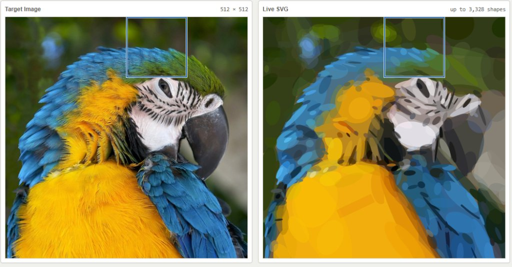

# SVG Painter

Converts raster images into layered SVGs, a few shapes at a time.

**Live demo:** [rynr.dev/svgpainter](https://rynr.dev/svgpainter/)



In a loop, the model compares the target image to its current canvas, predicts up to 8 primitives (rectangles, ellipses, triangles, quadratic curves, and closed blobs), draws them, and repeats. After painting the full image, it zooms into 2x, 4x, 8x, and 16x tiles, clipping each tile's shapes to its bounds. A small offset head adjusts rectangles and ellipses by 1-2 px for sub-grid alignment.

Runs in PyTorch or in the browser via ONNX Runtime Web (WebGPU encoder + WebAssembly decoder, or WebAssembly).

## Results

96 held-out 512x512 images (48 Twemoji, 48 COCO photos), PSNR (dB) on the painter's canvas with plan `1:128,2:64,4:8` (512 shapes total):

| Head | 128 flat | 128 photo | 384 flat | 384 photo | 512 flat | 512 photo | SSIM |
|---|---:|---:|---:|---:|---:|---:|---:|
| `grad` | 33.74 | 21.64 | 40.48 | 23.91 | 41.92 | 24.54 | 0.869 |
| `edge` (browser) | 32.93 | 21.60 | 39.79 | 23.85 | 41.40 | 24.48 | 0.868 |

Rendered with `resvg`, flat graphics score ~0.6 dB lower at 512 shapes (photos within 0.05 dB) due to slight antialiasing differences on shape edges. Deeper plans (`1:128,2:64,4:8,8:8,16:8`, 3,072 shapes, `grad` head, 48 images) reach 47.1 dB on flat graphics and 27.0 dB on photos.

## Usage

### Python

```bash
pip install -r requirements.txt
python paint.py photo.jpg logo.png --ckpt weights/painter.pt --heads weights/heads.pt --out out/
```

Use `--plan` to set `zoom:shapes_per_tile` (default `1:128,2:64,4:8`) and `--head edge` for the browser refinement head. Checkpoints are `painter.pt` (31.4M params) and `heads.pt`.

### Browser

```bash
python export_onnx.py --ckpt weights/painter.pt --heads weights/heads.pt --eval_pack data/pack_eval --out web
cd web && npm install && npm test
python3 serve.py 8000   # http://127.0.0.1:8000/
```

`serve.py` sets the `COOP`/`COEP` headers needed for multi-threaded WebAssembly. Exported weights are ~123 MB. Pass `?backend=wasm` or `?threads=N` to override defaults.

## Training

```bash
sh reproduce.sh
```

Downloads COCO (`test2017`/`val2017`) and Twemoji 15.1, runs the greedy search teacher, trains all stages (supervised pretraining, closed-loop REINFORCE with MSE+LPIPS, 2x tile zoom, and offset heads), evaluates, and exports ONNX. Requires one 32 GB GPU (~3 h teacher search + ~10 h training on an RTX 5090). Run `sh reproduce.sh --help` for stage flags and defaults; setting any stage to `0` skips it, and completed stages are skipped on reruns.

## Architecture

- **Encoder:** Stacks `target`, `canvas`, and `target - canvas` channel-wise through a 4-stage conv stem into 1,024 tokens (16 px patches) and 8 transformer layers.
- **Decoder:** 6-layer causal transformer emitting up to 106 grammar tokens per group with fixed-size KV caches, masked logits, and Fourier numeric features.
- **Local glimpses:** Once a shape's anchor is predicted, cross-attention uses a Gaussian window around the anchor alongside multi-scale pixel samples and 9x9 glimpse crops.
- **Offset heads:** Small MLPs run on the frozen painter's rectangle/ellipse outputs using boundary samples (`edge`, plus error gradients for `grad`), keeping a move only if it reduces pixel error.

## Layout

- `svg_painter/`: core package (`grammar.py`, `raster.py`, `model.py`, `paint.py`, `offset.py`, `teacher.py`, `synth.py`, `data.py`, `episodes.py`, `metrics.py`)
- `prep_images.py`, `make_teacher.py`, `pack.py`: data preparation
- `train_sl.py`, `train_rl.py`, `train_offset.py`: training stages
- `evaluate.py`, `paint.py`, `export_onnx.py`: evaluation, CLI inference, ONNX export
- `web/`: browser UI, JS inference engine, Node parity tests

Run `python -m tests.test_core` to check grammar round-trips, rasterizer parity with `resvg`, and cached decoding parity.

## Licenses & Credits

- **Twemoji** (`jdecked/twemoji` 15.1): CC BY 4.0, © Twitter, Inc and other contributors.
- **COCO**: Flickr photos under their respective licenses ([cocodataset.org](https://cocodataset.org)). Datasets are not bundled.
- **Sample images:** 4 Twemoji graphics (CC BY 4.0), plus [Hot Air Balloon over Lake](https://commons.wikimedia.org/wiki/File:Hot_Air_Balloon_over_Lake.jpg) (ISO Republic, CC0) and [Ara ararauna portrait Rhodes](https://commons.wikimedia.org/wiki/File:Ara_ararauna_portrait_Rhodes.jpg) (Jebulon, CC0).
